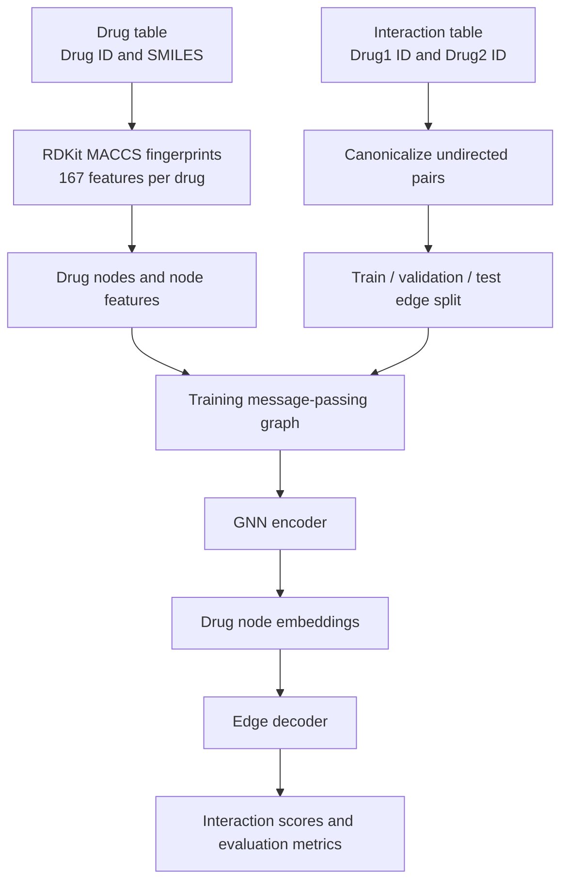

# Drug–Drug Interaction Prediction with Graph Neural Networks

[](https://www.python.org/)
[](https://pytorch.org/)
[](https://www.dgl.ai/)

A framework for representing drugs as nodes in a graph and predicting candidate drug–drug interactions (DDIs) with graph neural networks (GNNs). It packages the core workflow from the original notebook-based project into reusable Python modules, command-line tools, and a Kaggle quick-start workflow.

> **Research use only.** Model scores are computational predictions, not clinically validated evidence. This software is not medical advice and must not be used to make treatment, prescribing, or patient-safety decisions.

## Highlights

- **Six GNN model families:** GCN, GAT, GraphSAGE, Jumping Knowledge GCN (JKNet), VGAE, and R-GCN encoders.
- **Binary DDI link prediction:** five model families (GCN, GAT, GraphSAGE, JKNet, and VGAE) can be trained and compared on the supplied two-CSV DDI task.
- **Molecular features:** RDKit-generated 167-bit MACCS fingerprints derived from SMILES, preserving the original project's feature representation.
- **Leakage-aware graph splitting:** only training positive edges are used for message passing; sampled negatives exclude known positive pairs.
- **Reusable workflow:** shared data preparation, model factory, training, checkpointing, evaluation, and pair-scoring interfaces.
- **Kaggle-oriented setup:** documented DGL/PyTorch compatibility profile and an example notebook.

## Table of contents

- [Project overview](#project-overview)
- [How the pipeline works](#how-the-pipeline-works)
- [Supported models](#supported-models)
- [Repository structure](#repository-structure)
- [Data](#data)
- [Environment and installation](#environment-and-installation)
- [Quick start](#quick-start)
- [Use the Python API](#use-the-python-api)
- [Compare models](#compare-models)
- [Predict candidate interactions](#predict-candidate-interactions)
- [Run on Kaggle](#run-on-kaggle)
- [Evaluation protocol and limitations](#evaluation-protocol-and-limitations)
- [Tests](#tests)
- [Contributing and support](#contributing-and-support)
- [References and acknowledgements](#references-and-acknowledgements)
- [License and data terms](#license-and-data-terms)

## Project overview

This project develops a framework for representing drugs as nodes in a graph and predicting candidate drug–drug interactions (DDIs) with graph neural networks (GNNs). 

The main task treats each drug as a node and each known interaction as an undirected positive edge. Each drug is represented by a 167-dimensional MACCS fingerprint generated from its SMILES string. A GNN learns node embeddings from the training graph; an edge decoder then assigns a score to a candidate drug pair.

This repository is a research codebase, not a clinical decision-support system. Its outputs must be independently validated before any scientific or practical interpretation.

## How the pipeline works



For the binary DDI task:

1. DrugBank identifiers and SMILES are read from the drug table.
2. SMILES strings are converted into 167-bit MACCS fingerprints using RDKit.
3. Interaction pairs are mapped to drug-node indices and canonicalized as undirected pairs, so `(A, B)` and `(B, A)` represent the same edge.
4. Positive links are split into training, validation, and test sets. Only training positives are placed in the message-passing graph.
5. A selected GNN encoder generates node embeddings. A dot-product or symmetric MLP decoder scores candidate pairs (VGAE uses its variational inner-product decoder).
6. Validation ROC-AUC is used for early stopping; the best checkpoint is evaluated on the held-out test edges.

## Supported models

| Model | Implementation | Role in this repository |
|---|---|---|
| **GCN** | [`models/gcn.py`](src/drugddi/models/gcn.py) | DGL `GraphConv` baseline for binary DDI link prediction. |
| **GAT** | [`models/gat.py`](src/drugddi/models/gat.py) | Multi-head graph attention for learning neighbor-weighted representations. |
| **GraphSAGE** | [`models/graphsage.py`](src/drugddi/models/graphsage.py) | Neighborhood aggregation with `mean`, `gcn`, `pool`, or `lstm` aggregators. |
| **JKNet** | [`models/jknet.py`](src/drugddi/models/jknet.py) | Combines representations from multiple GNN depths using `cat`, `max`, or `lstm` aggregation. |
| **VGAE** | [`models/vgae.py`](src/drugddi/models/vgae.py) | Variational node encoding with an inner-product decoder and KL-divergence regularization. |
| **R-GCN** | [`models/rgcn.py`](src/drugddi/models/rgcn.py) | Relation-aware encoder for homogeneous graphs with meaningful edge-type IDs. |
| **Heterogeneous R-GCN** | [`models/hetero_rgcn.py`](src/drugddi/models/hetero_rgcn.py) | Encoder for DGL heterographs with typed node and edge relations; a featureless drug/gene embedding helper is also provided. |

### Which models can I train on the supplied DDI CSVs?

The original interaction CSV contains pairs of drugs but does not provide multiple biological relation types. Therefore, the binary DDI training CLI supports **GCN, GAT, GraphSAGE, JKNet, and VGAE**. R-GCN encoders are included for graph data with real, semantically meaningful relation labels, including appropriate heterogeneous drug/gene graphs. R-GCN is not exposed as a model choice in the binary DDI training CLI, and this bundle does not include an end-to-end supervised R-GCN drug–gene training pipeline.

Do not convert positive/negative training labels into R-GCN relation types. A prediction label is not a biological edge-relation category. See the [model guide](docs/MODEL_GUIDE.md) and [upstream references](docs/UPSTREAMS.md) for more detail.

## Repository structure

```text
.
├── README.md
├── pyproject.toml              # Package metadata and dependency constraints
├── requirements.txt            # Runtime dependencies
├── configs/                    # Example task and model configuration files
├── data/                       # Place the original CSVs here (not redistributed)
├── docs/
│   ├── KAGGLE.md                # Detailed Kaggle installation and execution guide
│   ├── MODEL_GUIDE.md           # Model selection and relation-type notes
│   └── UPSTREAMS.md             # Original project and architecture references
├── notebooks/
│   ├── 01_kaggle_quickstart.ipynb
│   └── README.md                # Notes on original research notebooks
├── scripts/
│   ├── check_environment.py
│   ├── train.py
│   ├── benchmark.py
│   └── predict.py
├── src/drugddi/
│   ├── data/                    # CSV readers, molecular features, splits, graph creation
│   ├── models/                  # GCN, GAT, GraphSAGE, JKNet, VGAE and R-GCN encoders
│   ├── tasks/                   # DDI task helpers and drug/gene R-GCN wrapper
│   ├── training/                # Shared trainer and checkpoint utilities
│   ├── evaluation/              # Link-prediction metrics
│   └── inference.py             # Checkpoint loading and candidate-pair scoring
└── tests/                       # Data, splitting, metrics, package and model tests
```

The original exploratory and autoencoder notebooks are **not copied into this refactor bundle**. Their names and upstream location are documented in [`notebooks/README.md`](notebooks/README.md) and [`docs/UPSTREAMS.md`](docs/UPSTREAMS.md).

## Data

The two source CSV files are not redistributed with this repository. Obtain them from the [original project](https://github.com/r-b-1-5/Predicting-Drug-Interactions-using-Graph-Neural-Networks-DGL-) and review the data provider's terms before use.

Place the files in `data/`, or pass a different directory with `--data-dir`.

| File | Required columns | Description |
|---|---|---|
| `drugIDandSMILES.csv` | `Drug ID`, `SMILES` | DrugBank identifier and the corresponding SMILES string. |
| `interaction_list.csv` | `Drug1 ID`, `Drug2 ID` | Known drug–drug interaction pairs. |

The loaders trim column names and identifier whitespace and normalize IDs to strings. Duplicate drug IDs are rejected. Interactions whose IDs are not present in the drug table are filtered and counted during data preparation.

By default, an invalid or unparsable SMILES string receives an all-zero 167-bit feature vector, matching the original notebook's initialized-zero feature behavior. For stricter input validation, the Python API supports `invalid_smiles_policy="raise"`.

## Environment and installation

### Supported compatibility profile

The package metadata currently targets **Python 3.10–3.12**, **PyTorch 2.4.1**, and **DGL 2.4.0**. Python 3.11 is a practical default for a reproducible environment. This is a pinned compatibility profile—not a claim that independently installing the newest available PyTorch and DGL releases will work together.

DGL contains compiled components. Select the PyTorch, CUDA, Python, and DGL wheels as a compatible set. The commands below use the CUDA 12.4 PyTorch/DGL wheel profile; use the official installation selectors if your platform requires another build.

- [DGL installation guide](https://www.dgl.ai/pages/start.html)
- [PyTorch previous versions and wheel selectors](https://pytorch.org/get-started/previous-versions/)

### Prerequisites

- Python 3.10, 3.11, or 3.12.
- A compatible PyTorch 2.4.1 and DGL 2.4.0 installation.
- RDKit for SMILES featurization.
- A working C/CUDA driver stack if using a GPU build.

### GPU installation (CUDA 12.4 example)

Create a clean virtual environment. The commands below are for Linux/macOS shells; Windows activation differs.

```bash
python3.11 -m venv .venv
source .venv/bin/activate
python -m pip install --upgrade pip

# Install matching PyTorch and DGL CUDA 12.4 wheels first.
python -m pip install torch==2.4.1 \
  --index-url https://download.pytorch.org/whl/cu124
python -m pip install dgl==2.4.0 \
  -f https://data.dgl.ai/wheels/torch-2.4/cu124/repo.html

# Install the remaining dependencies and this project.
python -m pip install -r requirements.txt
python -m pip install -e . --no-deps
```

### CPU installation

```bash
python3.11 -m venv .venv
source .venv/bin/activate
python -m pip install --upgrade pip

python -m pip install torch==2.4.1 \
  --index-url https://download.pytorch.org/whl/cpu
python -m pip install dgl==2.4.0 \
  -f https://data.dgl.ai/wheels/torch-2.4/repo.html

python -m pip install -r requirements.txt
python -m pip install -e . --no-deps
```

Check the installed stack before training:

```bash
python scripts/check_environment.py
```

The check reports Python, PyTorch, CUDA, DGL, RDKit, NumPy, pandas, and scikit-learn versions. If DGL fails to import, verify the selected Python/PyTorch/CUDA/DGL wheel combination rather than trying to force-install an incompatible wheel.

## Quick start

After installation and placing both CSV files in `data/`, train a GraphSAGE model:

```bash
python scripts/train.py \
  --data-dir data \
  --model graphsage \
  --epochs 200 \
  --device auto \
  --output-dir artifacts/graphsage
```

Available DDI model choices are `gcn`, `gat`, `graphsage`, `jknet`, and `vgae`.

Other examples:

```bash
# GCN baseline
python scripts/train.py --data-dir data --model gcn \
  --output-dir artifacts/gcn

# GAT with four attention heads
python scripts/train.py --data-dir data --model gat --gat-heads 4 \
  --output-dir artifacts/gat

# JKNet with four layers and concatenation aggregation
python scripts/train.py --data-dir data --model jknet \
  --jk-layers 4 --jk-mode cat --output-dir artifacts/jknet

# Variational graph autoencoder
python scripts/train.py --data-dir data --model vgae \
  --output-dir artifacts/vgae
```

Use `python scripts/train.py --help` to see all available training options.

A training run saves the model checkpoint, training graph, drug-ID mapping, training metrics, and run configuration to the chosen output directory:

```text
artifacts/graphsage/
├── model.pt
├── train_graph.bin
├── drug_id_map.json
├── training_result.json
└── run_config.json
```

No pretrained checkpoint is included. These commands train a model from the supplied CSV data.

## Use the Python API

The same data preparation, model, and training components can be used directly from Python:

```python
import torch

from drugddi.data.prepare import prepare_ddi_data
from drugddi.models.factory import create_model
from drugddi.training.trainer import (
    LinkPredictionTrainer,
    TrainingConfig,
    set_seed,
)

# Set seeds before constructing the model.
set_seed(42)

prepared = prepare_ddi_data(
    drug_csv="data/drugIDandSMILES.csv",
    interaction_csv="data/interaction_list.csv",
    validation_fraction=0.10,
    test_fraction=0.20,
    negative_ratio=1.0,
    seed=42,
)

model = create_model(
    "graphsage",  # gcn, gat, graphsage, jknet, or vgae
    in_features=prepared.features.shape[1],
    hidden_features=64,
    out_features=32,
    dropout=0.2,
    aggregator_type="mean",
)

trainer = LinkPredictionTrainer(
    model=model,
    graph=prepared.graph,
    features=prepared.features,
    config=TrainingConfig(
        epochs=200,
        learning_rate=1e-2,
        patience=30,
        predictor="dot",
        seed=42,
    ),
    device=torch.device("cuda" if torch.cuda.is_available() else "cpu"),
    embedding_dim=32,
)

result = trainer.fit(prepared.split)
print(result["test_metrics"])
```

Model-specific options can be passed through `create_model`:

- **GAT:** `num_heads=4`.
- **GraphSAGE:** `aggregator_type="mean"`, `"gcn"`, `"pool"`, or `"lstm"`.
- **JKNet:** `num_layers=4` and `jk_mode="cat"`, `"max"`, or `"lstm"`.
- **VGAE:** uses its own inner-product decoder and KL-divergence term; use `predictor="dot"` in `TrainingConfig`.

For the low-level R-GCN and heterogeneous R-GCN encoder interfaces, see [`docs/MODEL_GUIDE.md`](docs/MODEL_GUIDE.md).

## Compare models

Run a comparison across all five binary-DDI-ready models using the same data-splitting settings and seed:

```bash
python scripts/benchmark.py \
  --data-dir data \
  --epochs 200 \
  --seed 42 \
  --device auto \
  --output-dir artifacts/benchmark
```

To compare a subset:

```bash
python scripts/benchmark.py --data-dir data \
  --models gcn gat graphsage --epochs 200 \
  --output-dir artifacts/benchmark
```

The benchmark writes `benchmark_results.csv`, including each model's best validation ROC-AUC, test metrics, best epoch, and runtime. VGAE uses its built-in inner-product decoder; do not select the MLP decoder when benchmarking VGAE.

## Predict candidate interactions

Create a candidate-pairs CSV with the columns `Drug1 ID` and `Drug2 ID`. Both IDs must already exist in the graph used to train the checkpoint.

```bash
python scripts/predict.py \
  --checkpoint artifacts/graphsage/model.pt \
  --graph artifacts/graphsage/train_graph.bin \
  --pairs-csv candidate_pairs.csv \
  --output predictions.csv \
  --device auto
```

The output CSV contains:

- `drug_a`
- `drug_b`
- `interaction_probability`

**Inference is transductive:** a checkpoint contains the learned embedding model and the training graph's drug-ID mapping. Unseen drug IDs are rejected. Predicting for a new drug requires a separate workflow that computes its features and incorporates it into a suitable graph; this capability is not provided by the current inference command.

Only load checkpoint files you trust. PyTorch checkpoint loading uses Python serialization and may execute code embedded in an untrusted file.

## Run on Kaggle

The repository includes a [Kaggle quick-start notebook](notebooks/01_kaggle_quickstart.ipynb) and a more detailed [Kaggle setup guide](docs/KAGGLE.md).

At a high level:

1. Add this repository to the Kaggle working directory (or attach it as a Kaggle Dataset).
2. Attach a Kaggle Dataset containing `drugIDandSMILES.csv` and `interaction_list.csv`.
3. Inspect the notebook's Python, PyTorch, CUDA, and GPU runtime before installing DGL.
4. Use a Python 3.10–3.12 environment and install matching PyTorch/DGL wheels. The Kaggle guide demonstrates an isolated environment under `/kaggle/working/ddi-venv`.
5. Run `scripts/train.py` through that environment and save checkpoints/predictions under `/kaggle/working`.

Kaggle's base image changes over time. Do not assume its preinstalled PyTorch or Python version matches the pinned DGL profile. If the runtime does not have a supported Python version or a matching DGL wheel, use a compatible runtime/environment rather than forcing an installation. Kaggle's `/kaggle/input` is read-only; write model artifacts to `/kaggle/working`.

## Evaluation protocol and limitations

The binary DDI evaluator reports:

- **ROC-AUC**
- **Average precision (AP) / area under the precision–recall curve**
- **Precision**
- **Recall**
- **F1-score**

Important interpretation notes:

- The source interaction table contains known positive interactions; it does not provide experimentally confirmed non-interactions. Sampled non-edges are **unobserved pairs treated as benchmark negatives**, not evidence that a drug pair is safe or has no interaction.
- Drug pairs are canonicalized as undirected edges before splitting. The validation and test positive edges are excluded from the training message-passing graph.
- Negative sampling excludes all known positive pairs and samples without replacement.
- The task is **transductive**: the current checkpoint and inference workflow assume that candidate drug IDs are present in the training graph.
- Training currently uses full-batch message passing. Large graphs may exceed available memory; neighbor-sampled/minibatch DDI training is not included in this bundle.
- The MACCS representation is retained to preserve the original task setup. The molecular graph autoencoder experiments in the upstream notebook repository are references only and are not migrated as complete training pipelines here.
- The drug/gene R-GCN modules provide encoder components, not a complete reproduction of the original dataset-specific drug–gene experiment.

Use a fixed seed and identical splits when comparing architectures. Report the split strategy, negative-sampling ratio, model configuration, and runtime alongside performance metrics. Do not compare results produced with different data splits as if they were controlled model comparisons.

## Tests

Install the development dependencies and run the test suite:

```bash
python -m pip install -e ".[dev]"
pytest -q
```

The data, splitting, package, and metric tests can run without DGL. DGL-dependent model-forward tests are skipped when DGL is unavailable. For a full model verification, run the suite inside the pinned DGL/PyTorch environment:

```bash
python scripts/check_environment.py
pytest -q
```

## Contributing and support

Bug reports, documentation improvements, and reproducible research contributions are welcome. When opening an issue or pull request, include:

- the Python, PyTorch, DGL, RDKit, and CUDA versions;
- the model name and relevant configuration;
- the command or minimal code needed to reproduce the issue;
- the error traceback and, where relevant, a small data-free test case.


## References and acknowledgements

- **Original DDI project:** [Predicting Drug Interactions using Graph Neural Networks (DGL)](https://github.com/r-b-1-5/Predicting-Drug-Interactions-using-Graph-Neural-Networks-DGL-)
- **Project organization reference:** [CarDS-Yale/PanEcho](https://github.com/CarDS-Yale/PanEcho)
- **GCN:** [DGL GraphConv](https://github.com/dmlc/dgl/blob/master/python/dgl/nn/pytorch/conv/graphconv.py)
- **GAT:** [DGL examples](https://github.com/dmlc/dgl/tree/master/examples) and [DGL GATConv documentation](https://www.dgl.ai/dgl_docs/en/2.4.x/generated/dgl.nn.pytorch.conv.GATConv.html)
- **GraphSAGE:** [williamleif/GraphSAGE](https://github.com/williamleif/GraphSAGE)
- **Jumping Knowledge:** [xnuohz/JKNet-dgl](https://github.com/xnuohz/JKNet-dgl)
- **VGAE:** [tkipf/gae](https://github.com/tkipf/gae)
- **R-GCN:** [DGL heterogeneous R-GCN example](https://github.com/dmlc/dgl/blob/master/examples/pytorch/rgcn-hetero/entity_classify_mb.py)
- **Frameworks:** [DGL](https://www.dgl.ai/), [PyTorch](https://pytorch.org/), and [RDKit](https://www.rdkit.org/).

A curated list of additional architecture links and source details is maintained in [`docs/UPSTREAMS.md`](docs/UPSTREAMS.md).
